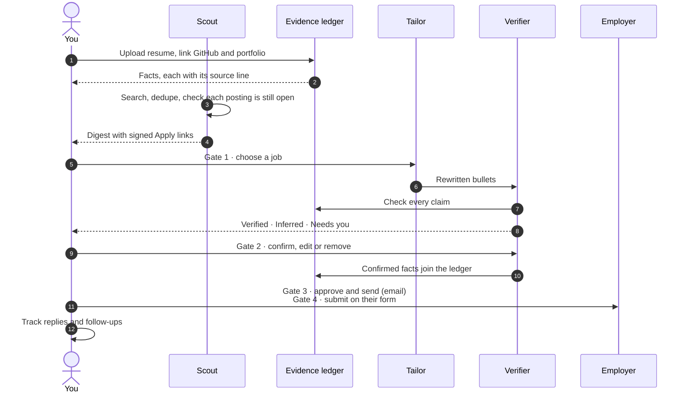
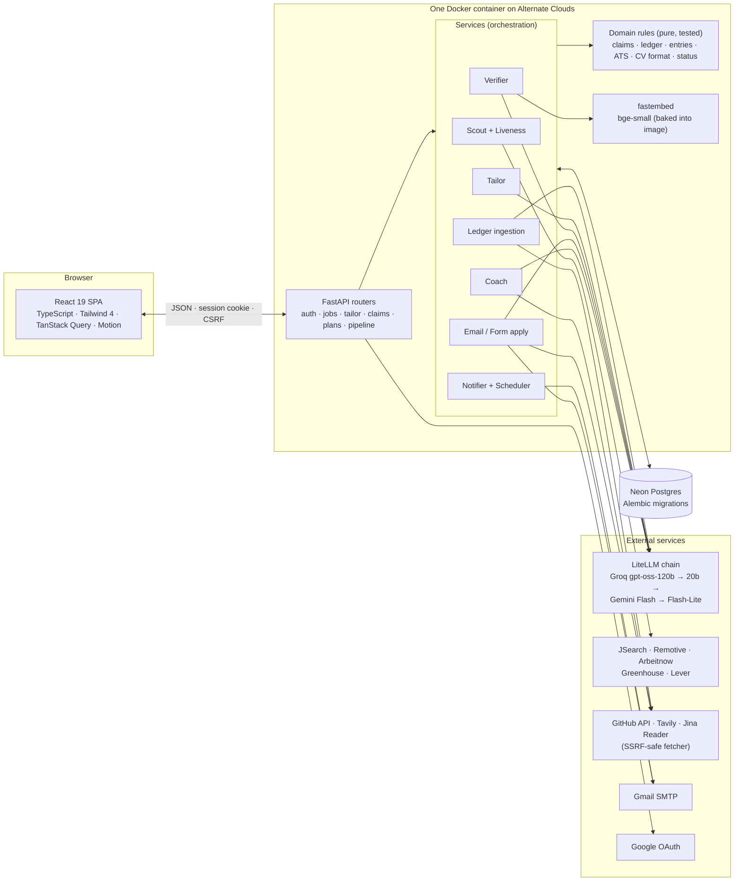

<div align="center">

# 💗⚡ Power Hunt

**A job hunting agent that only says what it can prove.**

It finds jobs, tailors your CV, drafts the application and checks every claim against evidence,
and you approve each step before anything leaves your hands.

*NASCON '26 · Agentika 2.0 · Theme: Human + AI, Better Together*

[Live demo](#links) · [How it works](#how-it-works) · [Architecture](#architecture) ·
[Run it](#run-it-locally) · [Eval](#claim-checker-eval)

</div>

---

## The problem

Job seekers either send one generic CV everywhere or spend hours rewriting it for each posting.
AI tools speed up the rewriting but invent skills, inflate numbers and add titles the person never
held, which gets candidates rejected or worse. Power Hunt is for students and early-career
engineers who want tailored applications at scale **without a single unproven claim**.

## The idea: no source, no claim

Every fact Power Hunt may say about you lives in an **evidence ledger**, and each fact points at
its source: a line of your resume, a GitHub repo, a page of your portfolio, or your own
confirmation. When the AI writes a CV line or an email, a **Verifier** finds every claim in it and
routes each one:

| Bucket | Meaning |
|---|---|
| ✅ **Verified** | The ledger proves it (same number and unit, same skill, same degree at the same school, same role at the same employer). |
| 🔗 **Inferred** | A faithful rewording of one of your lines that adds nothing new (embedding similarity, tuned on an eval). |
| ❓ **Needs you** | Anything else. You confirm it with a link or note, edit it, remove it, or mark it false so it is never suggested again. |
| ⛔ **Blocked** | Something you marked false before. Removed automatically. |

## Where the human comes in

The AI does the searching, scoring, writing and checking. **You make every decision that matters**,
at four gates, because each one is a judgment only the candidate can make:

| Gate | You decide | Why a human |
|---|---|---|
| **1. Choose** | Which jobs to apply to (from the digest or the Jobs page) | Only you know which roles you actually want. |
| **2. Verify** | Every claim the AI couldn't prove | Only you know whether "led a team of 5" is true. Your answer teaches the ledger, so you are asked less next time. |
| **3. Approve** | The final CV, email and cover letter | Your name goes on it. Nothing is sent without your click. |
| **4. Submit** | Form answers, filled in on the employer's own site | Employers' forms are yours to submit; Power Hunt prepares, you press send. |

You can also steer the agent at any time: revise the CV with your own instructions, track jobs you
applied to yourself, delete any fact, and turn every animation off with Calm mode.

## What it does

- **Scout**: searches your target roles and places on JSearch, Remotive and Arbeitnow (or a job
  you paste), removes duplicates, and checks each posting on the employer's own site so closed jobs
  never reach you. A digest emails the best matches with signed one-click Apply links.
- **Matcher and ATS score**: scores fit from the skills your ledger proves, and an ATS keyword
  score before and after tailoring.
- **Evidence ledger**: built from your resume (PDF or DOCX, including two-column layouts), GitHub
  and portfolio. Facts are tied to their entry, so a degree belongs to its school and a role to its
  employer.
- **Tailor**: rewrites only your bullet lines for the job, never adding facts, then the Verifier
  checks every claim. Compare with your own words, revise with your own instructions.
- **CV PDFs**: three ATS-friendly single-column layouts (Harvard serif, Jake's compact, Modern),
  each read back with a PDF parser and checked (every line readable, at most two pages, name first,
  sections in order) before you can download it.
- **Apply by email or form**: drafts the email and cover letter (verified like the CV), or reads
  the employer's form (Greenhouse, Lever or any page), answers each question by type and builds an
  Apply Pack.
- **Coach**: turns a skill gap into a small project with steps, 2 to 3 concrete project ideas with
  downloadable one-page proposals, and verifies the finished repo on GitHub before the skill joins
  your ledger.
- **Tailor tab**: every application by stage (picked, tailoring, ready, applied, follow-up due,
  interview, offer), including jobs you applied to on your own.
- **Activity**: an audit timeline of everything the agent did and every decision you made.

## How it works



## Architecture



**Design rules** that keep it trustworthy:

- **The LLM proposes, code decides.** Models write language and propose facts; deterministic,
  unit-tested domain code decides what is true, how it scores and what status it has.
- **Untrusted text stays data.** Resumes, job descriptions, web pages and form questions reach a
  model only inside delimited data blocks, and every model answer is validated against a schema.
  A malicious job description is tested end to end.
- **Every URL from a user** goes through an SSRF-safe fetcher: public IPs only, pinned to the
  checked address, redirects re-checked, size and time capped.
- **Configuration, not code**, differs between environments: every setting is declared and
  documented in [`app/config.py`](app/config.py).

Code map, data model and security notes: [docs/ARCHITECTURE.md](docs/ARCHITECTURE.md).

## Built with

| Layer | Technology |
|---|---|
| Approach | Custom code (no n8n): Python backend, React frontend, one Docker image |
| Backend | Python 3.12, FastAPI, SQLAlchemy 2 (async), Alembic, Pydantic v2, structlog, APScheduler |
| Database | Neon serverless Postgres (SQLite for tests) |
| AI models | `openai/gpt-oss-120b` and `gpt-oss-20b` on Groq, Gemini Flash and Flash-Lite as fallbacks, all through LiteLLM with strict JSON schemas; `BAAI/bge-small-en-v1.5` embeddings via fastembed (CPU) |
| APIs | JSearch (RapidAPI), Remotive, Arbeitnow, Greenhouse and Lever job boards, GitHub REST, Tavily search, Jina Reader, GeoNames (offline), Google OAuth 2.0 (PKCE), Gmail SMTP |
| Documents | pdfplumber and python-docx to read resumes; fpdf2 to write CVs, cover letters and proposals |
| Frontend | React 19, TypeScript (strict), Vite, Tailwind CSS 4, TanStack Query, Motion, lucide icons |
| Quality | pytest (640+ tests), mypy strict, ruff, oxlint, claim-checker eval in CI, bandit, pip-audit, gitleaks |
| MCP | Not used in this version |

## Security and privacy

- Passwords hashed with argon2; server-side sessions with per-session CSRF tokens; signed,
  single-use, expiring Apply and verification links (only hashes stored).
- **Email verification** before any digest or application is sent; a sign-in alert on every login;
  Google sign-in on an address with an unverified password account removes that password.
- Rate limits on login, signup and expensive endpoints; request size limits; upload checks by
  magic bytes; strict security headers.
- No secrets in the repo (gitleaks in CI). **Delete my data** removes the account and everything it
  owns. Logs carry event names and ids, never resume text, emails or tokens.

## Run it locally

### Prerequisites

- Docker Desktop (running)
- Node 22 (for the frontend dev server)
- Python 3.12 (only to run checks outside Docker)

### Setup

```bash
git clone https://github.com/rimsha-hue/hunt-powerpuffgirls.git
cd hunt-powerpuffgirls
python -m venv .venv && . .venv/bin/activate        # Windows: .venv\Scripts\activate
pip install -e ".[dev]"
python scripts/sync_env.py --demo-account          # writes .env with every setting and a demo login
cd frontend && npm ci && npm run build && cd ..
```

Fill in the keys you have in `.env` (see [Configuration](#configuration)). With no LLM key the app
still works: facts come from deterministic parsing and the Tailor reorders bullets in your words.

### Start

```bash
docker compose up --build          # API + built UI on http://localhost:8000
                                   # runs migrations and seeds the demo account at start
cd frontend && npm run dev         # optional: hot-reload UI on http://localhost:5173
```

### Checks (the same as CI)

```bash
ruff format --check app tests eval scripts && ruff check app tests eval scripts
mypy app eval
pytest -q --timeout=120            # offline: temporary SQLite, fakes for every external API
python -m eval.run --check         # claim checker eval against eval/baseline.json
cd frontend && npx oxlint && npm run build
```

### Production image, exactly as deployed

```bash
docker build -t power-hunt .
docker run --rm -p 8000:8000 --env-file .env -e APP_ENV=production power-hunt
```

Production refuses to start without a strong `SECRET_KEY`.

## Configuration

Every setting is declared and documented in [`app/config.py`](app/config.py);
`scripts/sync_env.py` writes them into `.env` with their defaults and never overwrites your values.

| Needed for | Keys |
|---|---|
| Everything | `SECRET_KEY`, `DATABASE_URL` (Neon `postgresql://...?sslmode=require`), `APP_BASE_URL` |
| Demo account | `DEMO_USER_EMAIL`, `DEMO_USER_PASSWORD` (created at startup) |
| AI | `GROQ_API_KEY`, optionally `GEMINI_API_KEY`; model names in `LLM_PRIMARY_MODEL`, `LLM_FALLBACK_MODEL`, `GEMINI_MODEL`, `GEMINI_FALLBACK_MODEL` |
| Job search | `RAPIDAPI_KEY` (JSearch); `SCOUT_MAX_QUERIES`, `SCOUT_INTERVAL_HOURS`, `JOB_OPEN_RECHECK_HOURS`, `DEMO_MODE` |
| Email | `SMTP_USER`, `SMTP_APP_PASSWORD` (Gmail app password), `EMAIL_VERIFY_HOURS`, `LOGIN_ALERTS`; development only: `EMAIL_REDIRECT_TO` |
| Company research | `TAVILY_API_KEY` (without it, facts come from the job description) |
| Google sign-in | `GOOGLE_CLIENT_ID`, `GOOGLE_CLIENT_SECRET`; redirect URI `{APP_BASE_URL}/api/auth/google/callback` |
| GitHub limits | `GITHUB_TOKEN` (fine-grained, public repos, read-only) |

## Deploy to Alternate Clouds

1. Create a service from this repository, branch `main`, root `.`; the Dockerfile is used.
2. Container port `8000`; health check path `/ready`.
3. Set the variables from `.env` with `APP_ENV=production`, the public `APP_BASE_URL`, a fresh
   `SECRET_KEY`, and **no** `EMAIL_REDIRECT_TO`. Mark keys as secret.
4. Add `{APP_BASE_URL}/api/auth/google/callback` to the Google OAuth client's redirect URIs.
5. Deploy, then open `/health`: database, LLM and scheduler should all report ok.

Migrations run automatically at container start (`alembic upgrade head`), and the embedding model
is baked into the image, so the first request needs no download.

## Claim checker eval

Does the Verifier catch invented claims without flagging true ones? `python -m eval.run` answers
with numbers on 112 tailored CV bullets: 72 true (verbatim, paraphrased, or adding a skill the
ledger proves) and 40 planted fabrications of seven kinds (inflated numbers, fake degrees, fake
employers, unheld skills, added seniority, claims injected by a job description, meaning drift).
It runs the real Verifier with the bge-small model; the LLM claim pass is replayed, so the run is
deterministic and needs no key. The similarity threshold was tuned on one half and is reported on
the other.

| Run | Catch rate (fabrications flagged) | False alarm rate (true claims flagged) |
|---|---|---|
| Held-out half, threshold 0.85 | **95.0%** (19/20) | **2.8%** (1/36) |
| All 112 cases (CI baseline) | 92.5% (37/40) | 4.2% (3/72) |

Every inflated number, fake degree, fake employer, unheld skill, added seniority and injected claim
is caught. The misses are meaning drift ("reduced **latency** by 40%" when the resume says cost),
the known limit of a design that never lets a model decide truth. CI fails if the catch rate falls
or the false alarm rate rises against [`eval/baseline.json`](eval/baseline.json).

## API overview

| Path | Purpose |
|---|---|
| `GET /health`, `GET /ready` | Dependency status and readiness probe |
| `/api/auth/*` | Signup, login, Google sign-in, email verification, me, delete my data |
| `/api/profile`, `/api/meta/*` | Preferences (validated and normalised), client config and suggestions |
| `/api/resume`, `/api/github/sync`, `/api/portfolio/sync`, `/api/ledger` | Build and browse the evidence ledger |
| `/api/jobs`, `/api/jobs/fetch`, `/api/jobs/import`, `/apply/{id}?t=` | Jobs, Fetch now, add a job by link, signed Apply links (Gate 1) |
| `/api/jobs/{id}/tailor`, `/api/claims/{id}/decision` | Tailored CV and Needs-you answers (Gate 2) |
| `/api/jobs/{id}/application/*` | CV PDF and checks, email and form flows (Gates 3 and 4) |
| `/api/applications`, `/api/jobs/{id}/applied-elsewhere` | The applications pipeline |
| `/api/plans/*` | Growth plans, project ideas and proposals, GitHub verification |
| `GET /api/activity` | Audit timeline and human-gate counters |

## Project layout

```text
app/
  api/            FastAPI routers and schemas (thin)
  services/       orchestration: scout, ingestion, tailor, verifier, composer, coach, notifier
  domain/         pure rules with tests: claims, ledger, ATS, CV format, status, taxonomy
  integrations/   one adapter per external system: LLM, email, PDF, GitHub, job boards, fetcher
  db/             SQLAlchemy models and Alembic migrations
frontend/src/     React pages and components
eval/             claim checker eval: cases, ledger, baseline, runner
tests/            unit and integration tests (offline)
docs/             architecture, handover, spec, next steps
```

## Team

| Name | Role | GitHub |
|---|---|---|
| _Add full name_ | _Role_ | [@Tamkeen-Sara](https://github.com/Tamkeen-Sara) |
| _Add full name_ | _Role_ | [@rimsha-hue](https://github.com/rimsha-hue) |

## Links

| | |
|---|---|
| Live deployment (Alternate Clouds) | _add the public URL_ |
| Demo video (2 to 3 minutes) | _add the link_ |
| LinkedIn post | _add the link_ |

Judges: use the demo account given in the submission PDF. Its credentials are never stored in
this repository.

## Credits

- **Fonts:** Public Sans (USWDS, OFL 1.1), Tinos (Steve Matteson, OFL 1.1) for the serif CV, and
  Bangers and JetBrains Mono from Google Fonts (OFL 1.1). Licences in
  [`app/templates/fonts`](app/templates/fonts).
- **CV layouts** are our own fpdf2 implementations inspired by widely shared ATS-friendly formats:
  the Harvard career office resume and "Jake's Resume" (MIT licence, by Jake Gutierrez).
- **Data:** GeoNames place names (CC BY 4.0). Icons: lucide (ISC licence).
- **Characters:** The Powerpuff Girls are trademarks of Cartoon Network / Warner Bros. Discovery.
  They appear only in the team's own short intro and login clips, for a non-commercial student
  hackathon entry. The Power Hunt logo, hearts motif and palette are original.
- Built with help from AI coding assistants; every change was reviewed, tested and committed by
  the team.
