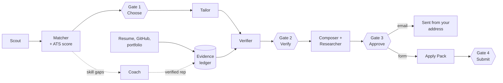
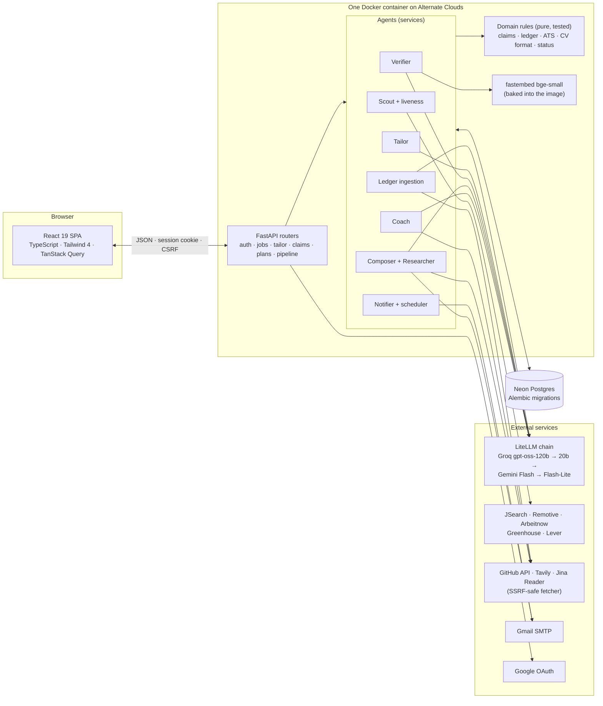

# Power Hunt

**A human-in-the-loop job application agent that proves every claim it writes.**

[](https://github.com/rimsha-hue/hunt-powerpuffgirls/actions/workflows/ci.yml)


Built for **NASCON '26 Agentika 2.0**, theme *"Human + AI: Better Together"*.

**Live:** https://alternate-vast-bay-2040-github-app.alternatefutures.ai
(demo account credentials are in the submission form)

---

## The problem

AI job tools write fast and invent freely. A tailored CV that claims a degree you don't hold, a
number you never hit or a skill you never used can cost you the job, or worse, the offer later.
Applicants either rewrite everything by hand or send what the model wrote and hope.

## The idea: no source, no claim

Power Hunt finds jobs, scores the fit, tailors your CV and prepares each application by email or
on the employer's own form. Before anything leaves your hands, it checks every claim it wrote
against your **evidence ledger**: your resume lines, your GitHub repos, your portfolio and your
own confirmations.

| Every claim is | When | Shown as |
|---|---|---|
| **Verified** | it matches a fact in your ledger (numbers by value and unit, skills through synonyms) | green badge with its source |
| **Inferred** | it closely rephrases one of your resume lines and adds nothing new | blue badge with the line |
| **Needs you** | nothing proves it | a question only you can answer |

When Power Hunt can't prove something, it asks you. Your answer joins the ledger, so the next
application asks less.

## Four human gates

The agents do the work; the decisions stay yours. Nothing passes a gate without you, and every
decision is written to an audit log.

| Gate | You | Why a human |
|---|---|---|
| 1. Choose | pick a job to apply for, from the app or the email digest | it's a career decision |
| 2. Verify | answer every claim Power Hunt could not prove: confirm with evidence, edit, remove or mark false | only you know the truth |
| 3. Approve | review and approve the final email or form answers | it goes out under your name |
| 4. Submit | press submit on the employer's site yourself | their forms, their terms; Power Hunt prepares, you submit |



## What it does

**Evidence ledger**
- Reads PDF and DOCX resumes, including two-column layouts. It ignores hidden text and rejoins
  wrapped lines, and every line gets a number that facts cite.
- A code pass finds skills (370 curated, with synonyms), degrees, metrics and certifications. An
  LLM proposes employers, roles and projects, and code keeps a proposal only if its cited line
  really says it.
- GitHub repos (languages and topics) and your portfolio page add evidence. Every fact shows where
  it came from, and you can delete any of them.

**Find and score jobs**
- The **Scout** searches JSearch, then Remotive and Arbeitnow, with recorded postings as a last
  resort. It runs every few hours and on demand, and dedupes by source id and by company, title
  and place.
- The **Matcher** scores fit from skills your ledger proves, the title and the place. The **ATS
  score** uses one fixed formula before and after tailoring, and it can only rise through keywords
  your ledger supports.
- Closed postings are detected from the source and the employer's own page, and moved out of the
  way.
- An email digest lists new matches, each with a signed, single-use **Apply now** link.

**Tailor and verify**
- The **Tailor** rewrites your bullets toward the job's keywords, one source line per bullet and
  never across jobs. You can revise it with your own instruction, and the revision is verified
  like any other.
- The **Verifier** combines a code pass (every number, skill, degree and employer) with an LLM
  pass (roles, projects, actions). Code routes each claim, using embedding similarity
  (bge-small) for paraphrases. Values you marked false are blocked automatically.
- The CV PDF comes in three ATS-safe templates (classic, compact, modern). It is read back after
  rendering to check that the text survives, nothing is clipped and the page count is right.

**Apply by email or on their form**
- The **Composer** drafts a short, plain email (120 to 180 words) and, when the posting asks, a
  cover letter. It finds the attachments the posting requires and lets you add or waive each one.
- Form questions come from the Greenhouse API, Lever, any apply page, or text you paste. Factual
  answers come from your profile and ledger, and written answers cite one company fact the
  **Researcher** found, with its source link.
- The **Apply Pack** gives every answer with a copy button, the files to upload and a link to the
  employer's form.

**Grow, don't fake**
- The **Coach** turns a skill gap into one small project: steps, an hour estimate and concrete
  project ideas with a downloadable one-page proposal.
- Link the repo when you're done. Power Hunt checks on GitHub that you own it, that it started
  after the plan, that it uses the skill and that it has enough commits. If every check passes,
  the skill joins your ledger and turns Verified everywhere.

**Track everything**
- **Applications:** pipeline stages, follow-up dates, outcomes, and jobs you applied for
  elsewhere.
- **Activity:** the audit timeline with each gate marked, plus counters for claims checked
  automatically, claims sent to you and unverified claims shipped (always zero).

## Proof that the checker works

`python -m eval.run` runs the real Verifier over **112 tailored CV bullets** written against the
demo resume. 72 are true and 40 are planted fabrications: inflated numbers, fake degrees, fake
employers, skills the user doesn't have, added seniority, claims injected by a job description,
and meaning drift. The similarity threshold was tuned on one half and is reported on the other.

| Run | Fabrications caught | True claims wrongly flagged |
|---|---|---|
| Held-out half, threshold 0.85 | **95.0%** (19/20) | **2.8%** (1/36) |
| All 112 cases (CI baseline) | 92.5% (37/40) | 4.2% (3/72) |

Every inflated number, fake degree, fake employer, unheld skill, added seniority and injected
claim is caught (32/32). The misses are meaning drift, where a real number is attached to a
different outcome in an almost identical sentence. That is the known limit of this design. CI
fails if a change lowers the catch rate or raises false alarms against `eval/baseline.json`.

A **malicious job description** is tested end to end. It tries to close its data block, issue a
"system override", add a PhD, an employer and a 95% result, and redirect email. With a model
scripted to obey it completely, none of it can be approved, the ATS score doesn't move and
nothing is sent.

## Security and reliability

- **Untrusted text stays data.** Resumes, job descriptions, web pages and form questions reach
  the LLM only inside delimited data blocks, and every reply is validated against a schema with
  one repair attempt.
- **SSRF-safe fetching.** Every URL from user input goes through one fetcher: public IPs only,
  pinned to the checked address, redirects re-checked, size and time capped.
- **Accounts.** argon2 passwords, server-side sessions (hashed tokens, HttpOnly, SameSite), a CSRF
  token on every state-changing request, Google sign-in with PKCE and nonce, email verification
  before any email is sent, and sign-in alerts.
- **Signed links.** Apply and verification links are random 32-byte tokens, stored only as
  hashes, single use and expiring.
- **Input guardrails.** Locations resolve against GeoNames, role titles, phones, LinkedIn URLs and
  salaries are normalised, uploads are checked by magic bytes and size, and request bodies are
  capped.
- **Headers and limits.** A strict Content-Security-Policy, nosniff, frame denial and HSTS in
  production. Login, signup and every LLM endpoint are rate limited.
- **Privacy.** Logs hold event names and ids only, never resume text, emails or tokens. "Delete my
  data" removes every row the account owns.
- **Fallbacks everywhere.** The LLM chain is Groq gpt-oss-120b, then gpt-oss-20b, then Gemini
  Flash, then Flash-Lite. Jobs fall back across three sources plus recorded postings. Every
  outbound call has a timeout and retries. The app keeps working with code-only extraction when
  no LLM is available.
- **Checks in CI:** ruff, mypy (strict), 644 tests, the eval baseline, bandit, pip-audit,
  gitleaks, the frontend lint and build, npm audit, and a Docker smoke test.

## Tech stack

| Layer | Tools |
|---|---|
| Backend | Python 3.12, FastAPI, Pydantic v2, SQLAlchemy 2 (async), Alembic, structlog |
| AI | Groq and Gemini through LiteLLM (strict JSON schemas), fastembed bge-small for similarity, YAKE for keywords |
| Data | Neon Postgres (SQLite in tests) |
| Integrations | JSearch, Remotive, Arbeitnow, Greenhouse, Lever, GitHub REST API, Tavily, Jina Reader, Gmail SMTP |
| Scheduling | APScheduler, in process |
| Documents | pdfplumber, python-docx, fpdf2 |
| Frontend | React 19, TypeScript (strict), Tailwind CSS 4, TanStack Query, Motion |
| Delivery | One multi-stage Docker image on Alternate Clouds; GitHub Actions CI |
| Approach | Custom code throughout (no n8n). No MCP server in this version. |

## Architecture

One container: FastAPI serves the JSON API under `/api`, health checks at `/health` and `/ready`,
and the built React app for every other path. All state lives in Postgres, so the container can
move between providers freely.



| Layer | Path | Rule |
|---|---|---|
| Domain | `app/domain/` | Pure functions: what counts as evidence, claim routing, ATS scoring, statuses, plan rules. No I/O. Fully unit tested. |
| Integrations | `app/integrations/` | One adapter per external system, with timeouts, retries and typed errors |
| Services | `app/services/` | The agents: Scout, Matcher, Tailor, Verifier, Composer, Researcher, Coach, Notifier |
| API | `app/api/` | Thin routers with Pydantic contracts |
| Frontend | `frontend/src/` | Pages for onboarding, ledger, jobs, workspace, apply pack, applications, growth plans, activity and profile |

The language model writes words and proposes facts. **Code decides** what is true, what score
something gets and what status it has.

## Run it locally

Requirements: Python 3.12, Node 22, Docker.

```bash
python -m venv .venv && .venv/bin/pip install -e ".[dev]"   # Windows: .venv\Scripts\...
cd frontend && npm ci && cd ..
python scripts/sync_env.py --demo-account      # writes .env with every setting; add your keys

docker compose up --build                      # API on http://localhost:8000 (migrates, seeds the demo user)
cd frontend && npm run dev                     # UI on http://localhost:5173
```

Every setting is declared and documented in [`app/config.py`](app/config.py).
`scripts/sync_env.py` adds new settings to `.env` without touching existing values.

| Needed for | Keys |
|---|---|
| Everything | `SECRET_KEY`, `DATABASE_URL` |
| Demo account | `DEMO_USER_EMAIL`, `DEMO_USER_PASSWORD` |
| AI | `GROQ_API_KEY`, optionally `GEMINI_API_KEY` |
| Job search | `RAPIDAPI_KEY` (JSearch); without it, Remotive, Arbeitnow and recorded postings |
| Company research | `TAVILY_API_KEY` |
| Email | `SMTP_USER`, `SMTP_APP_PASSWORD` (Gmail app password) |
| Google sign-in | `GOOGLE_CLIENT_ID`, `GOOGLE_CLIENT_SECRET` |
| GitHub limits | `GITHUB_TOKEN` (read-only) |
| Admin accounts | `ADMIN_EMAILS` (comma separated; each becomes an admin once its email is verified), or `python -m app.manage role <email> admin` |

### Tests and checks

```bash
ruff format --check app tests eval && ruff check app tests eval
mypy app eval
pytest -q                          # offline: temporary SQLite, fakes for every external API
python -m eval.run --check         # claim checker eval against the recorded baseline
cd frontend && npx oxlint && npm run build
```

## Deployment

Power Hunt runs on **Alternate Clouds** as a single container built from this repository's
`Dockerfile`. On startup it applies database migrations, seeds the demo account and starts
uvicorn.

| Setting | Value |
|---|---|
| Source | this repository, branch `main` |
| Port | container `8000`, public `80` |
| Health check | `GET /ready`, expect 200, timeout 10 s |
| Required variables | `APP_ENV=production`, `APP_BASE_URL` (full `https://` address), `SECRET_KEY` (32 or more characters), `DATABASE_URL`, plus the keys above |
| Never in production | `EMAIL_REDIRECT_TO` |

The app refuses to start with an invalid setting, such as a short secret or a base URL without
`https://`, so a misconfigured deploy fails loudly instead of running half-working. Google
sign-in needs `{APP_BASE_URL}/api/auth/google/callback` registered as a redirect URI.

## API overview

| Path | Purpose |
|---|---|
| `GET /health`, `GET /ready` | Dependency status and readiness probe |
| `/api/auth/*` | Signup, login, Google sign-in, email verification, me, delete my data |
| `/api/profile`, `/api/meta/*` | Preferences (validated and normalised), client config and suggestions |
| `/api/resume`, `/api/github/sync`, `/api/portfolio/sync`, `/api/ledger` | Build and browse the evidence ledger |
| `/api/jobs`, `/api/jobs/fetch`, `/api/jobs/import`, `/apply/{id}?t=` | Jobs, Fetch now, add a job by link, signed Apply links (Gate 1) |
| `/api/jobs/{id}/tailor`, `/api/claims/{id}/decision` | Tailored CV and Needs-you answers (Gate 2) |
| `/api/jobs/{id}/application/*` | CV PDF and format checks, email and form flows (Gates 3 and 4) |
| `/api/applications`, `/api/jobs/{id}/applied-elsewhere` | The applications pipeline |
| `/api/plans/*` | Growth plans, project ideas and proposals, GitHub verification |
| `GET /api/activity` | Audit timeline and human-gate counters |

## Known limitations

- **Meaning drift.** A proven number attached to a different outcome ("latency" instead of
  "cost") passes the checker; see the eval above.
- **Sending address.** Application emails are sent through one configured Gmail account, with
  Reply-To set to the applicant. Sending from each user's own mailbox would need Gmail OAuth.
- **Skill taxonomy.** It holds 370 skills with synonyms; rarer tools aren't recognised as skills
  yet.

## Team

| Name | GitHub |
|---|---|
| _Add full name_ | [@Tamkeen-Sara](https://github.com/Tamkeen-Sara) |
| _Add full name_ | [@rimsha-hue](https://github.com/rimsha-hue) |

## Credits

- **Fonts:** Public Sans (USWDS, OFL 1.1) and Tinos (Steve Matteson, OFL 1.1) in the PDFs, Bangers
  and JetBrains Mono from Google Fonts (OFL 1.1). Licences in
  [`app/templates/fonts`](app/templates/fonts).
- **CV layouts** are our own fpdf2 implementations inspired by widely shared ATS-friendly formats:
  the Harvard career office resume and "Jake's Resume" (MIT licence, by Jake Gutierrez).
- **Data and icons:** GeoNames place names (CC BY 4.0), lucide icons (ISC licence).
- **Characters:** The Powerpuff Girls are trademarks of Cartoon Network / Warner Bros. Discovery.
  They appear only in the team's own short intro and login clips, for a non-commercial student
  hackathon entry. The Power Hunt logo, hearts motif and palette are original.
- Built with help from AI coding assistants; every change was reviewed, tested and committed by
  the team.

---

*Power Hunt: the agents do the work, you make the calls, and nothing goes out that it can't
prove.*
